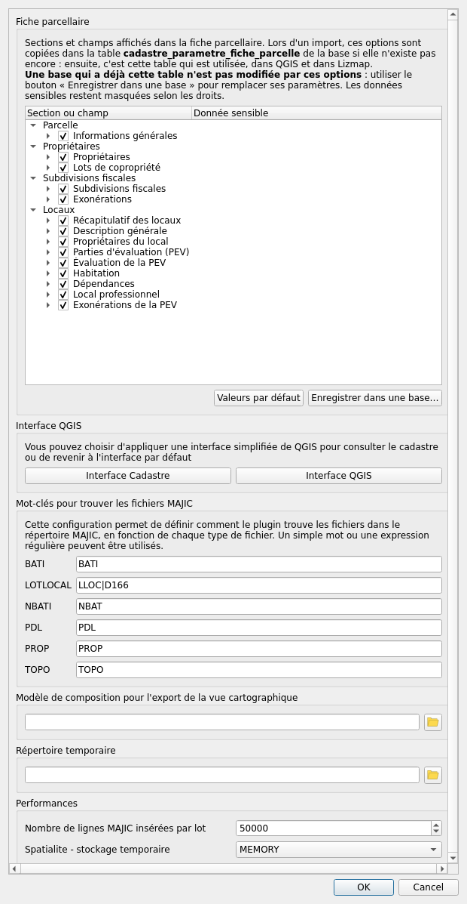

# Configuration

Avant d'importer les premières données cadastrales dans la base de données, vous pouvez si vous le souhaitez configurer
l'extension :

* Menu **Cadastre ➡ Configurer le plugin** ou l'icône **outils** de la barre d'outil Cadastre.

## Interface

Les deux boutons **Interface Cadastre** et **Interface QGIS** permettent d'ouvrir une aide pour appliquer une
interface simplifiée adaptée à une utilisation de consultation du Cadastre.

À ce jour, QGIS ne permet pas de modifier dynamiquement l'interface via une extension. Nous incorporerons cette
fonctionnalité lorsque ce sera possible. En attendant, il faut donc le faire manuellement, comme expliqué dans
la fenêtre d'aide.

## Mots-clés pour trouver les fichiers MAJIC

Cette partie permet de spécifier **comment sont recherchés les fichiers MAJIC** sur votre poste de travail
dans le répertoire que vous choisissez dans l'outil d'import.

Pour chaque type de fichier (propriétés bâties, non bâties, propriétaires, etc.), un mot-clé,
ou une liste de mots-clés séparés par `|` permettent de trouver les fichiers s'ils respectent
les conventions classiques de nommage.

Par exemple, les fichiers contenant les propriétaires peuvent s'appeller
`REVPROP.txt` ou `ART.DC21.W19132.PROP.A2019.N000688`. Dans ce cas,
il seront bien trouvés par le mot-clé `PROP`.

A noter :

* la recherche est **insensible à la casse**;
* les mots-clés sont en fait des **expressions régulières**. Par exemple `LLOC|D166`, qui permet
  de trouver les fichiers des locaux, trouve les fichiers contenant `LLOC` ou `D166`.

**Le plugin propose les mots-clés les plus courants. Vous pouvez les modifier si vos fichiers sont nommés différemment.**

Si l'extension ne trouve pas les fichiers MAJIC pendant l'import, alors que vous aviez spécifié le bon
répertoire d'import, un message vous avertira et vous proposera d'annuler l'import.

## Modèle de mise en page pour l'export de la vue cartographique

Vous pouvez choisir ici le modèle de mise en page d'impression qui sera utilisé dans la fonction **Export la
vue**. Un modèle est fourni dans le répertoire `composeur` de l'extension et sera utilisé si vous ne proposez
pas le vôtre.

Pour l'instant, le modèle gère un bloc de carte, mais pas les blocs de table attributaire.

## Répertoire temporaire

Vous pouvez choisir le répertoire dans lequel les scripts seront copiés et les fichiers décompressés.

Choisissez un répertoire contenant assez de place pour stocker les fichiers temporaires, surtout si vous
souhaitez charger des données volumineuses.

Ce répertoire est aussi celui dans lequel les **relevés parcellaires** et les **relevés de propriété** seront
exportés.

## Performances

Vous pouvez modifier dans ce groupe les options suivantes pour adapter l'extension aux performances de votre
matériel :

* **Taille maximum des requêtes INSERT** : C'est le nombre total de requêtes `INSERT` lancées dans un groupe de
  modification (`BEGIN/COMMIT`). Vous pouvez baisser le chiffre jusqu'à 10000 si vous avez une machine légère
  et un gros volume de données à importer. Plus le chiffre est bas, plus l'import initial peut prendre du
  temps.

* **Stockage temporaire** : Le mode *MEMORY* est plus rapide, mais nécessite assez de mémoire vive pour
  stocker les données à traiter. Le mode *DEFAULT* est plus lent et adapté à des ordinateurs avec peu de
  mémoire vive.

## Fiche parcellaire

Ce groupe permet de choisir les **sections** et les **champs** affichés dans la fiche parcellaire,
onglet par onglet. Décocher une section masque tous ses champs. Certains champs sont masqués par défaut,
comme les parts de valeur locative imposable dans le tableau des parties d'évaluation (PEV) des locaux.

Ces options sont aussi stockées dans la base de données, dans la table `cadastre_parametre_fiche_parcelle`
du schéma des données cadastrales :

* lors d'un **import**, la table est créée à partir des options si elle n'existe pas encore. Si elle existe déjà,
  ses paramètres sont conservés et seuls les champs absents, par exemple ajoutés par une nouvelle version
  de l'extension, sont ajoutés ;
* le bouton **Enregistrer dans une base…** remplace les paramètres de la table d'une base existante
  par les options cochées, sans refaire d'import.

Lorsque la base contient cette table, c'est elle qui est utilisée pour la fiche parcellaire, dans QGIS comme
dans Lizmap : tous les utilisateurs voient alors la même fiche. Sinon, ce sont les options de l'extension
qui sont utilisées.

La table contient une ligne par section et par champ, avec des libellés lisibles : elle peut aussi être
modifiée directement, en SQL ou dans la table attributaire de QGIS.

| Colonne    | Contenu                                                                               |
|------------|---------------------------------------------------------------------------------------|
| `cle`      | Identifiant de la section (`local.pevs`) ou du champ (`local.pevs.co_vlbaia`)          |
| `onglet`   | Onglet de la fiche                                                                    |
| `section`  | Libellé de la section                                                                 |
| `champ`    | Libellé du champ, vide pour une section                                               |
| `sensible` | `birth`, `revenue` ou `exoneration` pour une donnée sensible, vide sinon              |
| `visible`  | Section ou champ affiché                                                              |
| `ordre`    | Ordre dans la fiche                                                                   |

!!! note
    Ces paramètres ne donnent jamais accès aux données sensibles : un champ sensible peut être masqué, mais
    s'il est affiché, sa valeur reste remplacée par `XXX` ou `XX/XX/XXXX` pour un utilisateur qui n'a pas le droit
    de la voir (options d'export dans QGIS, droits du module Cadastre dans Lizmap).
