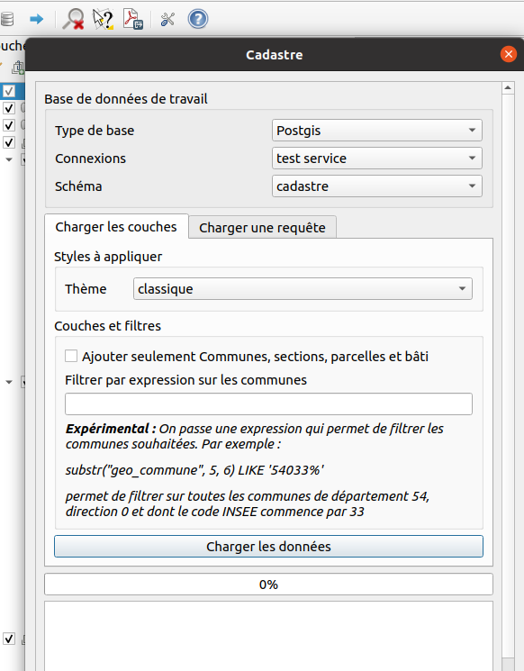
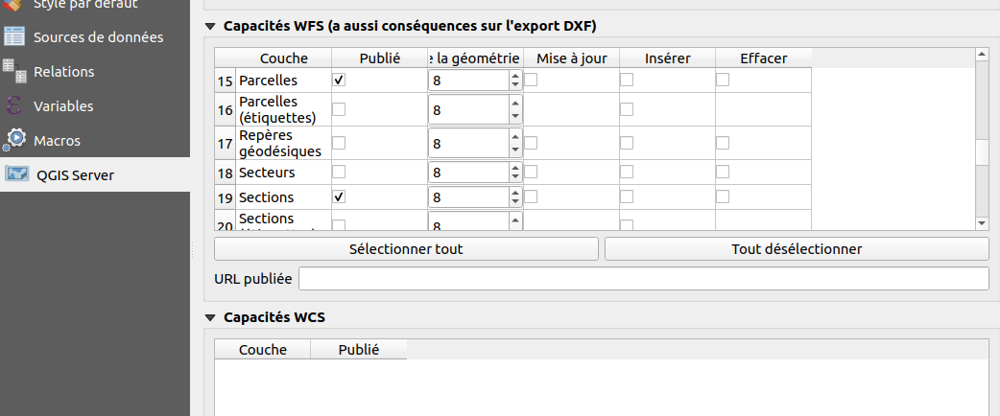
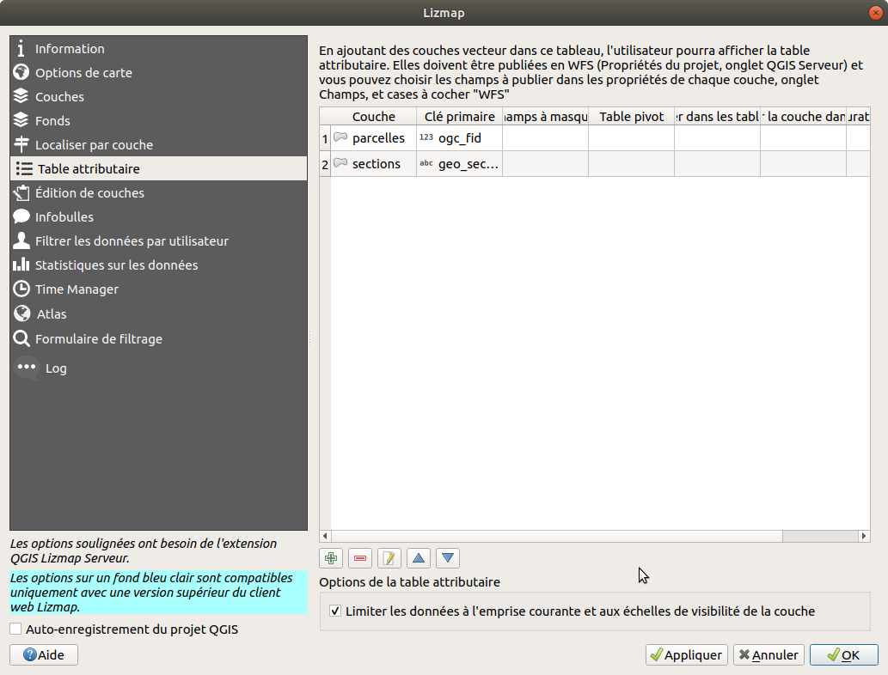
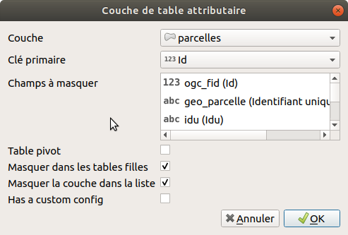

# Configuration

## Dans QGIS

### Configurer le projet QGIS

Pour utiliser le module cadastre dans **Lizmap Web Client** il vous faut d'abord configurer un **projet QGIS** :

* Vous aurez besoin d'installer l'extension QGIS [Cadastre](https://github.com/3liz/QgisCadastrePlugin)
sur votre QGIS Bureautique via le gestionnaire d'extensions, ainsi que sur votre serveur QGIS Serveur
dans un dossier nommé `cadastre`.

* Il faut ensuite créer un projet QGIS contenant les données cadastrales, et le configurer
avec l'extension **Cadastre** :

    - Utilisez l'outil de **chargement des couches**, il configurera notamment les **variables** dans le projet
  ainsi que les couches requises. Sinon, il faut utiliser l'algorithme de QGIS dans le menu **Traitements** pour
  **configurer le projet**.

    

    - Dans les **propriétés du projet**, onglet `QGIS Serveur`, il faut publier en WFS les couches
  `Communes`, `Parcelles` et `Sections`.

    

??? note "Liste des variables qui doivent être dans les propriétés du projet"
    Ces variables sont obligatoires dans les propriétés du projet pour avoir le module Cadastre fonctionnel sur le
    projet en question :

    * `cadastre_commune_layer_id`
    * `cadastre_commune_unique_field`
    * `cadastre_section_layer_id`
    * `cadastre_section_unique_field`
    * `cadastre_parcelle_layer_id`
    * `cadastre_parcelle_unique_field`

### Configurer la publication avec l'extension Lizmap

Vous devez maintenant créer ou modifier la configuration **lizmap** via l'extension Lizmap pour QGIS :

* Il faut obligatoirement ajouter la couche `Parcelles` dans l'onglet **table attributaire**.

    - Pour les performances, pensez à cocher la case **Limiter les données à l'emprise courante** en bas de la fenêtre
      pour l'onglet table attributaire

!!! tip Performance
    Pour les performances, vous pouvez aussi cocher **Masquer la couche dans la liste** pour la configuration de la
    couche `Parcelles`. La fonction de sélection sera active, mais la couche `Parcelles` n'apparaîtra pas dans la liste des
    tables attributaires disponibles.

* La couche `Parcelles` ne doit pas être dans un groupe qui a l'option `Groupe comme une couche` activée
dans l'onglet `Couches` de Lizmap.

* Vous devez activer la **popup** pour la couche des `Parcelles`, via l'onglet `Couches` de l'extension Lizmap.

!!! warning
    Selon le public visé, vous devrez adapter les champs visibles dans la popup de Lizmap,
    notamment les champs `proprietaire` et `proprietaire_infos` qui contiennent des données sensibles issues
    des fichiers MAJIC.

    - Si vous utilisez la popup **Automatique** de Lizmap, désactiver le WMS pour les champs souhaités dans l'onglet
    `Champs` des propriétés de la couche (tout à droite du tableau)

    - Si vous utilisez la popup **Infobulle QGIS**, adaptez la configuration en supprimant le contenu HTML non souhaité,
    visible dans l'onglet `Affichage` (ou `Infobulle`) des propriétés de la couche, groupe `Infobulle HTML`

* À noter que depuis la version **1.6.0** du module Cadastre, lorsque l'utilisateur a
**le droit de voir les données de propriétaires**, le contenu détaillé des informations de la parcelle est
**affiché sous le contenu de la popup**. Les onglets correspondent à ceux visibles dans QGIS lorsqu'on
affiche le détail d'une parcelle : **Parcelle, Propriétaires, Subdivisions fiscales, Locaux**. Vous pouvez donc afficher moins d'information dans la popup,
par exemple seulement le code de la parcelle et la commune
* Les sections et les champs affichés dans ce contenu sont ceux de la table `cadastre_parametre_fiche_parcelle`
de la base, voir la [configuration de l'extension QGIS](../extension-qgis/configuration.md#fiche-parcellaire).

## Dans Lizmap Web Client

Maintenant, vous devez configurer les droits d'accès à l'outil via l'interface d'administration.
Le module a créé un groupe d'utilisateurs `Cadastre Lizmap` (identifiant `cadastre_lizmap`), qui a tous
les droits du module, et les droits suivants :

| Droit | Donne accès à |
|-------|---------------|
| Utiliser le panneau de recherche | la recherche par commune, section, parcelle et adresse |
| Accéder aux données des propriétaires (noms et adresses) | la recherche par propriétaire et les exports CSV des parcelles et des locaux avec leurs propriétaires |
| Accéder aux dates et lieux de naissance des propriétaires | ces données dans la fiche, les relevés et les exports |
| Accéder aux informations de revenus | ces données dans la fiche et les relevés |
| Accéder aux informations d'exonérations fiscales | ces données dans la fiche et les relevés |
| Accéder à la fonction de relevé parcellaire | le bouton du relevé parcellaire (PDF) dans la popup |
| Accéder à la fonction de relevé de propriété | le bouton du relevé de propriété (PDF) dans la popup |
| Accéder aux onglets d'informations détaillées dans la popup des parcelles | les onglets de la fiche sous la popup, et leur impression |

Les dates et lieux de naissance, les revenus et les exonérations sont masqués (`XX/XX/XXXX`, `XXX`) sans
le droit correspondant. Les exports CSV des parcelles sélectionnées et les relevés parcellaire et de propriété
contiennent celles que les droits de l'utilisateur autorisent. Il peut aussi les produire pour un tiers, sans
ces données, par exemple pour un fichier transmis à une personne qui n'est pas autorisée à les connaître :

* pour les exports CSV, avec la case « Exporter pour un tiers », décochée par défaut ;
* pour les relevés, en choisissant « Pour un tiers (sans données sensibles) » dans le menu qui s'ouvre
  au clic sur le bouton du relevé, à la place de « Avec les données que je peux voir ».

La case et le menu ne sont proposés qu'aux utilisateurs qui ont au moins un des 3 droits sur les données
sensibles : sans eux, les exports et les relevés sont de toute façon ceux d'un tiers.

Vous pouvez mettre certains utilisateurs dans ce groupe `Cadastre Lizmap`. **Vous devez bien faire
attention de n'accorder les droits sur les propriétaires et leurs données qu'aux personnes habilitées !**

!!! note
    Avant la version 2.3.0 du module, il existait deux droits : `Accéder aux données de propriétaires
    simplifiées` et `Accéder aux données de propriétaires avancées`. Lors de la mise à jour du module,
    les groupes qui avaient le droit avancé reçoivent tous les nouveaux droits, et le droit simplifié devient
    `Accéder aux données des propriétaires (noms et adresses)` : rien ne change pour les utilisateurs.

Vous pouvez modifier plus finement les droits via le bouton `Changer les droits des groupes` situés
dans le menu `Groupes d'utilisateurs pour les droits` de l'interface d'administration de Lizmap Web Client.

!!! warning
    Cette page modifie fortement les droits par défaut des groupes d'utilisateurs.
    Nous conseillons de ne pas toucher aux droits liés à Lizmap ici, sauf si vous maîtrisez ce que vous faites.
