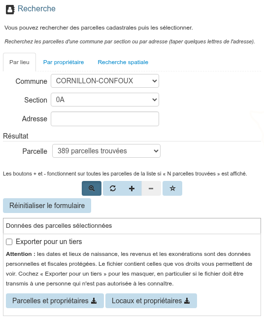
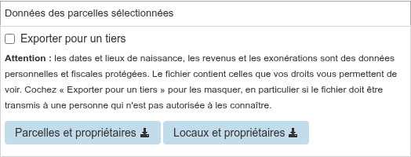
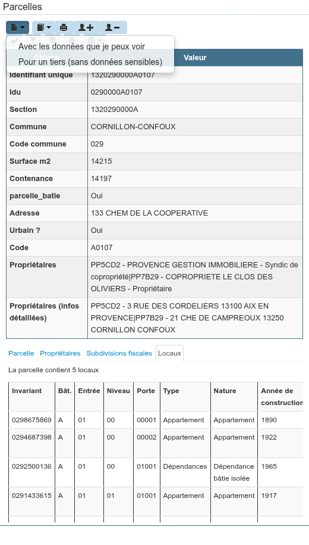

# Utilisation

Une fois le module [installé](installation.md) et le projet [configuré](configuration.md), les utilisateurs
de Lizmap disposent :

* d'un **panneau de recherche** des parcelles, ouvert par l'icône **Cadastre** du menu de gauche ;
* d'**exports CSV** des parcelles sélectionnées, en bas de ce panneau ;
* de **boutons et d'onglets** dans la popup des parcelles.

Ce que voit chaque utilisateur dépend de ses [droits](configuration.md#dans-lizmap-web-client) : par exemple,
la recherche par propriétaire, les exports et les boutons de la popup demandent l'accès aux données des
propriétaires.

!!! note
    Les copies d'écran utilisent les données fictives de test de l'extension : les propriétaires, adresses
    et valeurs sont inventés.

## Panneau de recherche

Le panneau propose trois onglets. Le texte au-dessus des onglets décrit celui qui est affiché.

### Par lieu

Recherche des parcelles d'une **commune**, par **section** ou par **adresse**. Pour l'adresse, tapez
quelques lettres du nom de la voie : une liste de voies est proposée.

La liste **Parcelle** du groupe **Résultat** contient alors les parcelles trouvées. Elle affiche
« N parcelles trouvées » tant qu'aucune parcelle n'est choisie : choisissez une parcelle pour la localiser,
ou utilisez les boutons de sélection pour toutes les sélectionner.

### Par propriétaire

Recherche des parcelles d'un propriétaire dans une **commune**, par son **nom** (tapez quelques lettres,
une liste de propriétaires est proposée) ou par son **numéro de compte**.

Cet onglet n'est affiché qu'aux utilisateurs qui ont l'accès aux données des propriétaires, et seulement
si la base contient les données MAJIC.

### Recherche spatiale

Recherche des parcelles proches des objets d'une autre couche du projet :

1. sélectionnez des objets dans une couche PostgreSQL du projet, de la même base que les données cadastrales
   et disponible dans la table attributaire ;
2. choisissez cette **couche**, le champ d'**identifiant** des objets et une distance (**tampon**, en mètres) ;
3. la liste **Parcelle** contient les parcelles situées à moins de cette distance des objets sélectionnés.

Si cet onglet est affiché au moment de l'export « Parcelles et propriétaires », le fichier contient en plus,
pour chaque propriétaire, les identifiants des objets proches de ses parcelles (colonne `code_objet`).

### Boutons de la barre d'outils

Sous les onglets, la barre d'outils agit sur la liste **Parcelle** de l'onglet affiché :

| Bouton | Action |
|--------|--------|
| Loupe (**Mode zoom**) | Activé (par défaut), la carte zoome sur l'élément choisi : commune, section, voie, propriétaire ou parcelle |
| Flèches (**Nouvelle sélection**) | Remplace la sélection par les parcelles de la liste |
| **+** (**Ajouter à la sélection**) | Ajoute les parcelles de la liste à la sélection |
| **-** (**Supprimer de la sélection**) | Retire les parcelles de la liste de la sélection |
| Étoile (**Désélectionner**) | Vide la sélection des parcelles |

Les boutons de sélection agissent sur toutes les parcelles de la liste si elle affiche
« N parcelles trouvées », sinon sur la parcelle choisie. Le bouton **Réinitialiser le formulaire** vide
tous les champs.

## Exports CSV des parcelles sélectionnées

En bas du panneau, deux boutons exportent dans un fichier CSV les données des parcelles sélectionnées
sur la carte, quelle que soit la façon dont elles ont été sélectionnées :

* **Parcelles et propriétaires** : une ligne par propriétaire, avec son adresse découpée (adresse, complément,
  code postal, ville), la liste de ses parcelles et, si l'onglet « Recherche spatiale » est affiché,
  les identifiants des objets proches. Ce fichier est adapté au publipostage ;
* **Locaux et propriétaires** : une ligne par local et par propriétaire, avec l'identification du local
  (bâtiment, entrée, niveau, porte, invariant), son adresse, sa nature et son occupation, et le propriétaire
  avec son droit.

Seules les parcelles que l'utilisateur peut voir sont exportées, selon les filtres de la couche des parcelles
(par utilisateur, par polygone).

Les fichiers contiennent les dates et lieux de naissance que les droits de l'utilisateur lui permettent de
voir. La case **Exporter pour un tiers** les masque (`XX/XX/XXXX`, `XXX`), par exemple pour un fichier
transmis à une personne qui n'est pas autorisée à les connaître. Elle n'est affichée qu'aux utilisateurs
qui ont au moins un droit sur les données sensibles.

## Popup des parcelles

### Boutons

Au-dessus des informations de la parcelle, selon les droits de l'utilisateur :

| Bouton | Action |
|--------|--------|
| Page (**Relevé parcellaire**) | Relevé parcellaire de la parcelle, en PDF |
| Livre (**Relevé de propriété**) | Relevé de propriété du compte de la parcelle, en PDF |
| Imprimante (**Imprimer le détail**) | Impression des informations détaillées de la parcelle |
| Personne **+** | Ajoute à la sélection toutes les parcelles du propriétaire |
| Personne **-** | Retire de la sélection toutes les parcelles du propriétaire |

Les boutons de sélection des parcelles du propriétaire ne sont proposés que si la couche des parcelles est
disponible dans la table attributaire du projet.

Pour un utilisateur qui a au moins un droit sur les données sensibles, un clic sur un bouton de relevé
propose de le produire **Avec les données que je peux voir** ou **Pour un tiers (sans données sensibles)**.
Sans droit sur les données sensibles, le relevé est produit directement, pour un tiers.

### Onglets d'informations détaillées

Sous les informations de la parcelle, pour les utilisateurs qui ont le droit correspondant, les onglets
**Parcelle**, **Propriétaires**, **Subdivisions fiscales** et **Locaux** affichent la fiche parcellaire,
comme dans QGIS. Les sections et les champs affichés sont ceux
de la table `cadastre_parametre_fiche_parcelle` de la base, voir la
[configuration de l'extension QGIS](../extension-qgis/configuration.md#fiche-parcellaire). Les données
sensibles sont masquées sans le droit correspondant.

Un contenu long ou large défile à l'intérieur de son onglet.
